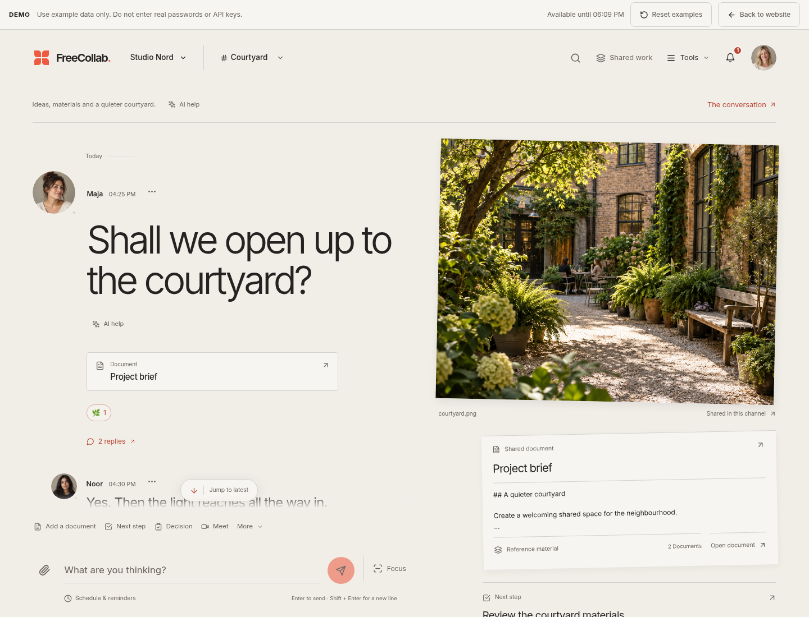

> **FreeCollab 0.11:** group conversations, scheduled messages, personal reminders, encrypted shared channels, installable apps, content search, recorded clips, local transcription, larger meetings, organization governance and native clients. [Choose infrastructure](docs/INFRASTRUCTURE.md) · [Apps](docs/APP_PLATFORM.md) · [Meetings](docs/MEETINGS.md) · [Validation](docs/VALIDATION.md).

# FreeCollab

Self-hosted collaboration with workspaces, private and encrypted channels, direct messages, files and decisions. MIT licensed.



FreeCollab brings conversations, documents, tasks, files and meetings into a workspace you control. Choose personal colors/type and Swedish or English, use your own customer SSO and prepare your organization's Microsoft 365/Google apps. The MIT-licensed source has no per-seat software fee; you cover hosting and external provider costs. Start with one API process; additional replicas require the shared coordination and storage described in [SCALING.md](docs/SCALING.md).

The website's **Explore the demo** opens a browser-only showroom at `/#demo`, with sample messages, tasks, editable Markdown, appearance and both provider setup guides. It requires no account and does not contact providers or save demo content. **Open App** enters the real authenticated application. For Railway, start with the [maintained deployment guide](RAILWAY_DEPLOY.md).

## Start the self-hosted pilot

Requirements: a Linux host, Python 3.11+, Docker with Compose v2, and a Docker daemon. From the repository root:

```bash
python scripts/pilot-init.py
docker compose --env-file pilot.env -p freecollab up --build -d --wait
```

Open `http://127.0.0.1:8080`. The initializer creates private, ignored `pilot.env` settings with random database credentials, a signing secret and a separate content-encryption key ring. It refuses to overwrite an existing file. Keep that file private and preserve the keys with your recovery plan.

The pilot binds its frontend to loopback; the API and database have no host ports. This is a local HTTP profile. An external installation needs HTTPS/WSS, explicit production settings and the deployment checks in [OPERATIONS.md](docs/OPERATIONS.md). The configuration does not publish an internet service or establish a hosted product account.

### First team workflow

1. Open the app and create a personal account.
2. Create a workspace and open **Get started** to set its name/logo, choose personal settings and create the first channel. Its creator is the channel admin.
3. Use **Members** to create a single-use invitation link. Share it with the intended teammate; the recipient signs in and explicitly joins.
4. Exchange messages, reply in threads and edit/delete your own messages.
5. Upload a permitted file and download it from another member account. Nonmembers cannot read the channel or its files.
6. Promote another member before the last channel admin leaves. Revoke an unused invitation or remove a member when access is no longer needed.

Invitations expire and store only a token hash. They grant membership, not operator privileges. See [CHANNELS.md](docs/CHANNELS.md). Organization-managed teams can instead provision or invite people through their own SSO without creating personal passwords; see [customer onboarding](docs/OIDC.md).

To create the first installation administrator, register the intended account, then run from trusted server access:

```bash
docker compose --env-file pilot.env -p freecollab exec backend \
  python -m app.cli bootstrap-admin --email operator@example.com
```

There is no public self-promotion endpoint. Channel admins and installation administrators have separate responsibilities.

## Workspace tools

Open **Work** in a channel for connected tools, including:

1. [Projects and tasks](docs/PROJECT_TASKS.md): Kanban boards, assignees, deadlines, checklists, current file/decision links and immutable revision history.
2. [Meetings](docs/MEETINGS.md): actual browser voice/video and screen sharing, host-admitted guests and explicit encryption status. Small calls support up to six admitted participants; Internet/NAT deployment needs operator-provided TURN.
3. [Mobile and offline](docs/MOBILE_OFFLINE.md): an installable PWA, encrypted device drafts and outbox, reconnection with idempotent delivery, optional generic Web Push. **Mobile** stays available even during an offline reload without loaded channels.
4. [Shared documents](docs/SHARED_DOCUMENTS.md): simultaneous Yjs editing, comments, named immutable revisions and restoration as a new edit. Native channel document updates are encrypted at rest; secure channels use verified encrypted Matrix events.
5. [Workflows](docs/WORKFLOWS.md): visual trigger/condition/step editing, approvals, bounded reminders and task/notification actions. Secure channels allow metadata rules and encrypted approval notes, with no server reading their content.
6. [Data controls](docs/DATA_CONTROLS.md): explicit channel exports, retention policy, reviewable deletion previews and permanent selected native-content erasure. Retention defaults to disabled and on hold. Personal account closure erases the login identity while retaining an opaque disabled author for shared history.

Workflows, export and erasure jobs use the durable integration worker, included by the start command above. External push needs independent VAPID credentials and browser consent. Neither export nor retention can decrypt or erase copies of Matrix history on other devices or homeservers. Account closure is separate from shared-content erasure and backup expiry.

## Product scope

The reference client includes email verification and recovery, MFA and sessions, workspace roles and guests, private channel membership, direct messages, real-time chat, threads, read receipts, reactions, mentions, local history search, file versions, private bookmarks and revisioned decisions. Optional client-side encryption uses a private Matrix service; see [the implementation and setup](docs/E2EE_IMPLEMENTATION.md). Member removal and logout are checked by REST and Socket.IO, including already connected clients.

The reference client uses a Scandinavian-inspired layout with warm surfaces, restrained colors and generous spacing. Open **Appearance** in the chat sidebar to preview your own palette, typeface, text size, spacing and corners. Choose Linen, Fjord, Clay or Ink, or enter custom accent and canvas colors; light, dark and system modes are available. **Save changes** stores preferences on your account, **Cancel** restores your saved appearance, and **Reset** previews the defaults until you save. The four type choices use bundled fonts or your device's system font, with no font CDN. See [personal appearance and its API](docs/APPEARANCE.md).

### Keyboard and reading

Open **Search & switch** in the sidebar or press **Cmd/Ctrl+K** to find your channels, open Appearance/Files/Members or create a channel. Quick-switcher matches use the current loaded conversation. **Search all history** separately loads authorized channel history onto the device, displays synchronization progress and supports channel, person and date filters. Its decrypted search data is cleared when the dialog closes; it is not sent to a server search index. Use **↑/↓** to choose a result, **Enter** to open it and **Escape** to close; prefix a query with `#` to show channels only.

In the composer, **Enter** sends and **Shift+Enter** inserts a new line. Enter used to compose text with an input method does not send prematurely. Drafts are encrypted in this browser’s private storage and survive channel switching and reloads. The encrypted outbox checks the current sign-in, channel access and encryption mode before reconnect delivery; review is required after a changed sign-in. When you scroll back, incoming messages preserve your reading position; **Jump to latest** takes you to the new messages and updates the read receipt. The [design and interaction guide](docs/DESIGN_SYSTEM.md) describes these behaviors and the shared dialog controls.

Advanced posts/flows, comments and the server AI-demo routes are **disabled by default**. `ENABLE_EXPERIMENTAL_FEATURES=true` opts into the advanced API routes; `ENABLE_DEMO_AI=true` separately opts into the AI-demo API. These are not dependencies of ordinary chat and need separate validation before use with real content.

The typed **`@freecollab/components@0.11.0`** SDK provides independently mounted chat, files, feed, notifications, tasks, shared documents, calendar, meetings, workflows, decisions and local search, with Web Components and optional React wrappers. Native components handle server-readable channels. The trusted-origin embed runs the full client, including its Matrix encryption, device verification and recovery, inside a customer's product. Configure **Integrations → Embedding** with the product's exact origin; the customer-owned SSO popup supplies a one-use PKCE launch code. See the [component and embedding guide](docs/COMPONENT_SDK.md), [identity model](docs/EMBED_IDENTITY.md) and [versioned artifact/publication procedure](docs/SDK_RELEASES.md). The package is locally buildable and packable; npm publication is a separate authenticated release step.

The older widget polls the latest 50 messages every three seconds and does not reconcile edits/deletions or recover larger gaps. [Its standalone integration example](examples/widget/README.md) remains available for this limited client.

Open **Integrations** for document links, calendar/ICS, customer SSO, directory management, cloud synchronization and authorized webhooks. Each workspace configures **its own** OIDC provider in **Sign-in**, using the customer's application and encrypted client secret. **People → Onboarding** keeps the default personal-link workflow or opts into separate managed accounts through SCIM, one-use invitations or explicit first-sign-in creation. **People → Directory & groups** supplies the owner-issued SCIM token and explicit group access rules. Equal email addresses never merge personal accounts or identities from different customers.

**Sync** connects a selected native channel's supported files or standalone calendar events to Google Drive/Calendar, Microsoft OneDrive/SharePoint/Outlook, Nextcloud WebDAV/CalDAV or generic CalDAV. The customer owns the OAuth application/account or DAV app password. Native password/MFA confirmation and explicit consent grant existing and future selected content; conditional writes and conflict review protect competing edits. Sync is bounded to a selected depth-one folder/calendar and does not mirror provider permissions. Server background synchronization rejects end-to-end encrypted channels; their document links and explicit local calendar exchange remain available. [INTEGRATIONS.md](docs/INTEGRATIONS.md) and [sync limits](docs/DOCUMENTS_CALENDAR.md#cloud-synchronization) describe setup. Webhooks, OTRUST and background sync are disabled by default and require the integration worker.

Native installation administrators also have **Integrations → Operations**: private security configuration, operator MFA coverage, upload-storage headroom, stalled queue claims and recent authenticated security actions. The bounded activity log excludes request bodies, query strings, IP addresses, email and credentials; it is a server-observed history under the database administrator's control. Configuration checks do not verify public certificates, provider delivery or backup freshness. See [security operations](docs/SECURITY_OPERATIONS.md).

## Data security

There are two explicit channel modes. Existing channels use **server-side encryption** with an independent versioned key ring; the server receives their plaintext. New secure channels use **client-side Matrix encryption**, including message/decision content, channel titles and encrypted attachments. Secure channels block legacy plaintext endpoints. See [E2EE_IMPLEMENTATION.md](docs/E2EE_IMPLEMENTATION.md) for setup, device verification, separate recovery keys and the metadata the service still sees.

Legacy file bytes remain unencrypted at the application-storage layer. Secure file bytes are encrypted before upload and verified/decrypted in the browser. Protect volumes and backups in either mode. Account passwords, MFA, server roles and content-key recovery are separate controls. HTTPS/WSS is required for deployed traffic. The FreeCollab integration has not received an independent security audit.

Before upgrading an older installation, retain the old content key, stop writers, back up and run the documented audit/migration. Do not assume rotating a signing secret can migrate legacy encrypted history. See [KEY_MANAGEMENT.md](docs/KEY_MANAGEMENT.md) and [SECURITY_MODEL.md](docs/SECURITY_MODEL.md).

The restore helper keeps outbound mail and integration workers stopped until explicitly resumed. An optional authenticated backup-sealing tool creates encrypted copies using a separate private key; it preserves the source backup and does not upload or schedule anything. [OPERATIONS.md](docs/OPERATIONS.md) documents sealing, key retention and isolated recovery.

## Run locally for development

Use Python 3.11 and Node 24 LTS (frontend minimum Node 22.12):

```bash
cd backend
python -m venv .venv
source .venv/bin/activate
# Windows PowerShell: .\.venv\Scripts\Activate.ps1
python -m pip install --require-hashes -r requirements-dev.lock
python -m uvicorn app.main:socket_app --reload --host 127.0.0.1 --port 8000
```

In a second terminal:

```bash
cd frontend
ONNXRUNTIME_NODE_INSTALL_CUDA=skip npm ci
npm run dev -- --host 127.0.0.1
```

Open `http://127.0.0.1:3000`. Vite proxies `/api` and `/socket.io` to the backend. The default database is SQLite and the development content key is generated once in a private file under `backend/data`; retain it with the database. Development defaults must remain local.

In a third terminal, activate the same backend virtual environment and run
`python -m app.services.integration_worker` from `backend/`. This processes
scheduled messages, reminders and other durable background jobs.

The Compose frontend also proxies `/api` and `/socket.io`, so its `VITE_API_URL` stays unset for the same-origin pilot. A separately hosted static frontend must set the complete HTTPS backend URL at build time and include its own HTTPS origin in backend `CORS_ORIGINS`.

## Configuration and operations

| Setting | Purpose |
| --- | --- |
| `ENVIRONMENT` | `development`, `test` or `production`. Public deployments use production. |
| `DATABASE_URL` | PostgreSQL connection string, or local SQLite for development. |
| `JWT_SECRET` | Private token-signing secret. Production requires at least 32 bytes. |
| `ACCOUNT_SECURITY_KEY` | Independent random base64 32-byte key for native factors/recovery mail, customer OIDC secrets, cloud OAuth tokens and DAV app passwords. Retain it with backups. |
| `PUBLIC_APP_URL` | Trusted public origin for mail links, customer SSO/cloud callbacks and SCIM endpoint URLs; HTTPS in production. |
| `MAIL_DELIVERY_MODE` | `disabled`, development-only private `file`, or `smtp`; delivery requires the mail worker. |
| `SMTP_HOST` / `SMTP_FROM` | SMTP endpoint and sender; configure verified STARTTLS or implicit TLS and provider credentials. |
| `MESSAGE_ENCRYPTION_KEYS` | JSON map of key IDs to independent random, base64-encoded 32-byte content keys. Required in production. |
| `MESSAGE_ENCRYPTION_ACTIVE_KEY_ID` | Key ID for new and edited message content. Retain required older keys. |
| `LEGACY_MESSAGE_ENCRYPTION_KEY` | Explicit old key while upgrading historical unversioned ciphertext. |
| `STORAGE_BACKEND` / `STORAGE_PATH` | `local` persistent upload directory, or customer-owned `s3`; see [object storage](docs/OBJECT_STORAGE.md) for configuration, migration and backup limits. |
| `REDIS_URL` | Optional private TLS Valkey coordination; replica requirements and fail-closed behavior are documented in [scaling](docs/SCALING.md). |
| `CORS_ORIGINS` | JSON array of exact allowed frontend origins. Production requires explicit HTTPS origins. |
| `MATRIX_ENABLED` / `MATRIX_SERVER_NAME` | Enable the private encrypted messaging service with a stable identity; start the `secure` Compose profile. |
| `MATRIX_REGISTRATION_SHARED_SECRET` | Private registration credential shared only by backend and Synapse; not a content key. |
| `OIDC_ENABLED` / `OIDC_ISSUER_URL` | Legacy installation-wide OIDC option. Customer workspace SSO is configured in the app and works independently of these settings. |
| `WEBHOOKS_ENABLED` | Signed metadata-only deliveries for explicitly granted channels; handled by the default integration worker. |
| `SYNC_ENABLED` | Opt-in background file/calendar synchronization for selected native channels; default `false`, handled by the integration worker. |
| `OTRUST_ENABLED` / `OTRUST_BASE_URL` | Explicit hash-only version timestamps; pending receipt and commitment checks are distinct from independently verified Bitcoin anchoring. |
| `OPERATIONS_METRICS_TOKEN` | Optional independent read-only metrics credential; all other diagnostics require an installation admin. |
| `SECURITY_AUDIT_RETENTION_DAYS` | Selected authenticated security activity age window; default 90 days, accepts 7–365. Existing backup copies have separate retention. |
| `SECURITY_AUDIT_MAX_RECORDS` | Activity record target; default 100,000, accepts 1,000–1,000,000. Age/cap cleanup is bounded per recorded write. |
| `ENABLE_EXPERIMENTAL_FEATURES` | Advanced API opt-in; default `false`. |
| `ENABLE_DEMO_AI` | Demo-AI API opt-in; default `false`. |

Use [OPERATIONS.md](docs/OPERATIONS.md) for initialization, health/readiness, database/file/key backup, restoration into a separate installation and deployment checks. The Railway, Fly and Render templates are configuration examples; they do not replace these checks or provision a complete verified hosted installation automatically.

Personal accounts support email verification, one-use password reset, password changes, per-session revocation, logout everywhere and authenticator MFA/recovery codes. Managed organization accounts instead use their customer's SSO and workspace-only identity; they do not have native password/reset access. SCIM provisioning/deactivation and explicitly approved group rules manage their access without claiming same-email personal accounts. An IdP-only disable does not revoke issued FreeCollab sessions: deliver SCIM deactivation or use membership/session controls.

Account access does not recover encrypted history. Personal accounts linked through customer SSO need a separate encryption unlock lasting up to 30 minutes; managed accounts use their isolated workspace encryption identity without a native-password unlock. Both still require device trust and the separate history recovery key. Customer sessions remain restricted to their workspace and provider revision. Email requires its configured worker/provider; local development uses private mail files. The default is one API process; replicas require shared authorization throttles and the complete [scaling configuration](docs/SCALING.md). Reviewed retention and account-closure controls have separate rules for shared content, preservation holds, Matrix devices and backups. [AUTH_SESSIONS.md](docs/AUTH_SESSIONS.md), [OIDC.md](docs/OIDC.md) and [data controls](docs/DATA_CONTROLS.md) describe the boundaries.

## Validation and project documents

```bash
(cd backend && .venv/bin/python -m pytest tests/ -q)
(cd frontend && npm run build && node --test tests/*.test.mjs)
```

- [Product plan and release gates](docs/PRODUCT_PLAN.md)
- [0.11 features and supported boundaries](docs/PRODUCT_011.md)
- [Native desktop and mobile clients](docs/NATIVE_CLIENTS.md)
- [Implementation and validation record](docs/VALIDATION.md)
- [Security model](docs/SECURITY_MODEL.md)
- [Private security status, activity and recovery](docs/SECURITY_OPERATIONS.md)
- [Dependencies, pinned installs and advisory checks](docs/DEPENDENCIES.md)
- [Channel API and invitation rules](docs/CHANNELS.md)
- [Personal appearance and preferences API](docs/APPEARANCE.md)
- [Design and interaction guide](docs/DESIGN_SYSTEM.md)
- [External integrations and setup](docs/INTEGRATIONS.md)
- [Standalone widget integration](examples/widget/README.md)

The validation record distinguishes local development, tested deployment artifacts and an external pilot. No statement here establishes a completed external security audit or a published deployment.

## License

[MIT](LICENSE).
